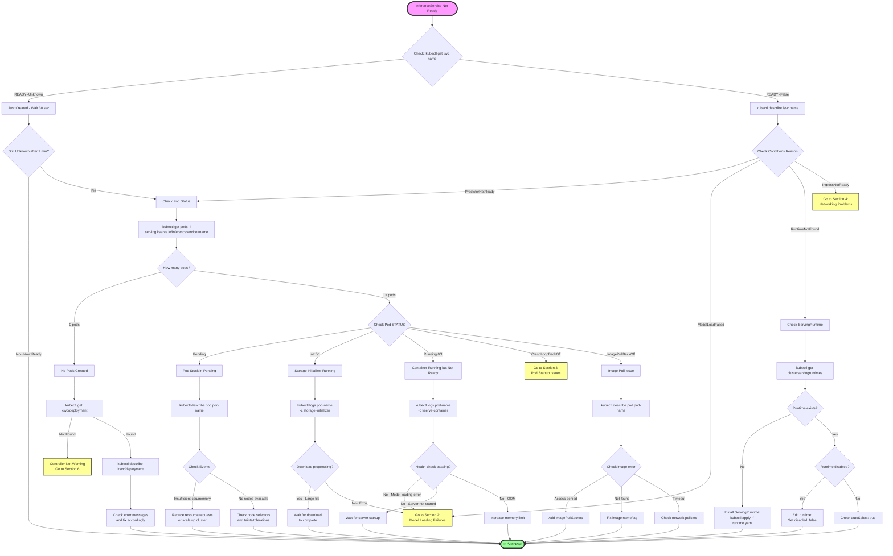
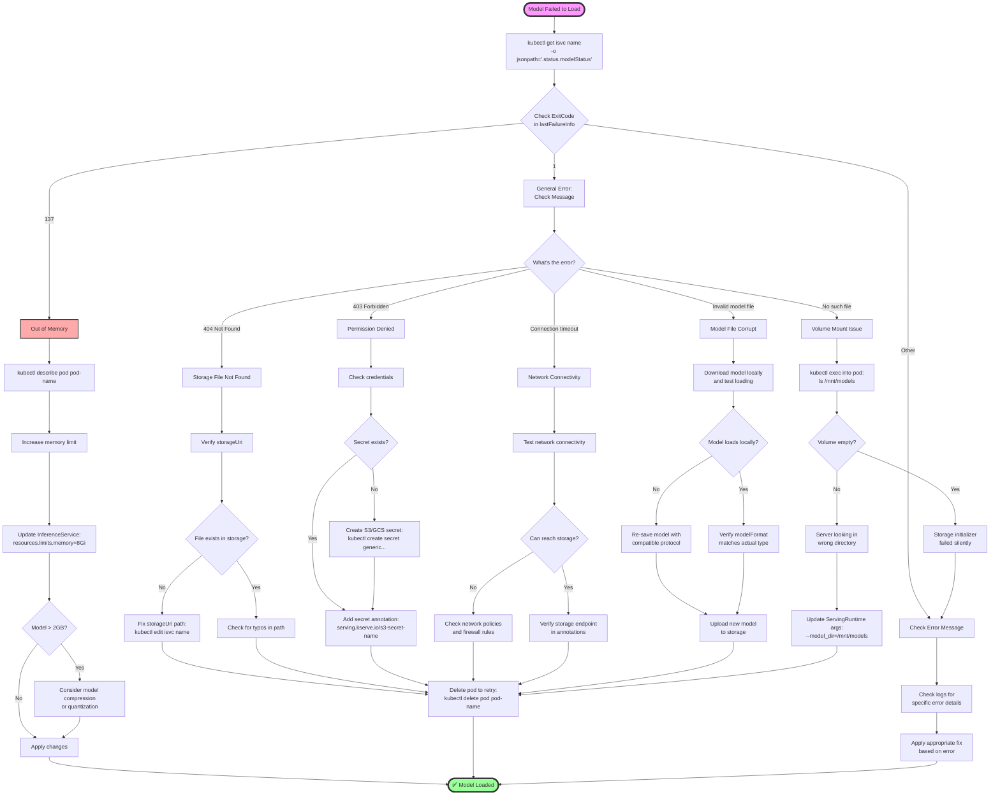
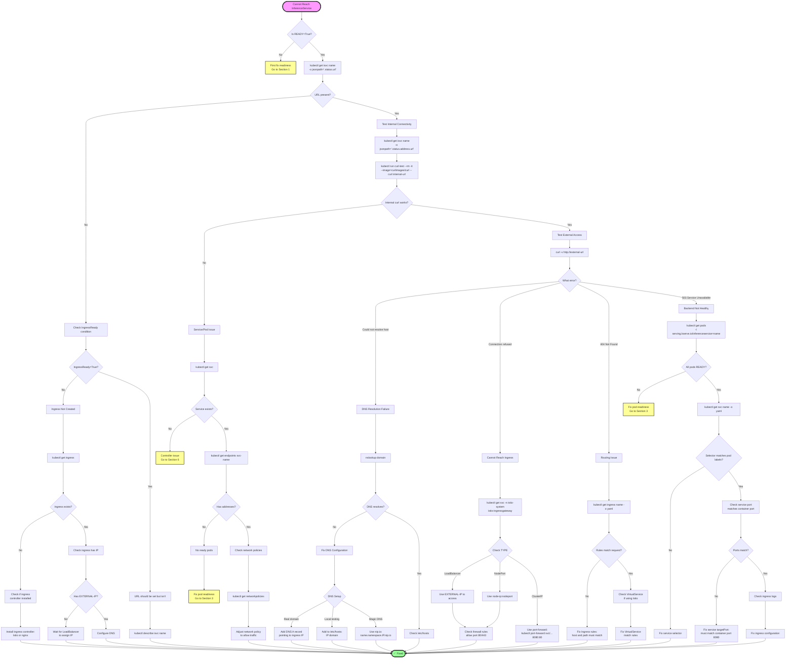

# KServe Troubleshooting Flowcharts

Visual decision trees using Mermaid diagrams to help you debug common KServe issues quickly.

---

## Table of Contents

1. [InferenceService Not Ready](#1-inferenceservice-not-ready)
2. [Model Loading Failures](#2-model-loading-failures)
3. [Pod Startup Issues](#3-pod-startup-issues)
4. [Networking Problems](#4-networking-problems)
5. [Performance Issues](#5-performance-issues)
6. [Controller Not Working](#6-controller-not-working)
7. [Quick Reference Commands](#quick-reference-common-commands)

---

## 1. InferenceService Not Ready

### Overview
When your InferenceService shows `Ready=False` or `Ready=Unknown`, follow this flowchart to diagnose the issue.

### Mermaid Flowchart



### Quick Commands

```bash
# Check overall status
kubectl get isvc <name>
kubectl describe isvc <name>

# Check pods
kubectl get pods -l serving.kserve.io/inferenceservice=<name>
kubectl describe pod <pod-name>

# Check logs
kubectl logs <pod-name> -c storage-initializer
kubectl logs <pod-name> -c kserve-container

# Check runtime
kubectl get clusterservingruntimes
kubectl describe clusterservingruntime <runtime-name>
```

---

## 2. Model Loading Failures

### Overview
When `ModelStatus` shows `FailedToLoad` or `BlockedByFailedLoad`, use this flowchart to identify the root cause.

### Mermaid Flowchart



### Common Error Messages and Fixes

| Error Message | Cause | Fix |
|--------------|-------|-----|
| `404 Not Found` | Wrong storageUri | Verify file exists: `aws s3 ls s3://bucket/path` |
| `403 Forbidden` | No credentials | Create secret and add annotation |
| `Connection timeout` | Network blocked | Check network policies |
| `Invalid model file` | Corrupt/wrong format | Re-save model with compatible protocol |
| `Exit Code 137` | Out of memory | Increase memory limit (2-3x model size) |

### Quick Commands

```bash
# Check model status
kubectl get isvc <name> -o jsonpath='{.status.modelStatus}'

# Check failure details
kubectl get isvc <name> -o jsonpath='{.status.modelStatus.lastFailureInfo}'

# Check storage initializer logs
kubectl logs <pod-name> -c storage-initializer

# Test storage access (for S3)
aws s3 ls s3://bucket/path/to/model

# Check secrets
kubectl get secret | grep s3
kubectl get secret | grep gcs

# Delete pod to retry
kubectl delete pod <pod-name>
```

---

## 3. Pod Startup Issues

### Overview
Diagnose why pods are not starting correctly (Pending, CrashLoopBackOff, ImagePullBackOff, etc.).

### Mermaid Flowchart



```mermaid
flowchart TD
    Start([Pod Not Starting]) --> GetPodStatus[kubectl get pod pod-name]

    GetPodStatus --> PodStatus{Check STATUS}

    PodStatus -->|Pending| Pending[Pod Stuck in Pending]
    PodStatus -->|ContainerCreating| Creating[Wait if < 30 sec]
    PodStatus -->|Init:0/1| InitContainer[Storage Initializer]
    PodStatus -->|Running 0/1 Ready| NotReady[Health Check Failing]
    PodStatus -->|CrashLoopBackOff| CrashLoop[Container Crashing]
    PodStatus -->|ImagePullBackOff| ImagePull[Cannot Pull Image]
    PodStatus -->|Error| ErrorState[Container Failed]

    Creating --> StillCreating{Still creating after 2 min?}
    StillCreating -->|No| Success([✅ Pod Started])
    StillCreating -->|Yes| Pending

    Pending --> DescribePending[kubectl describe pod pod-name]
    DescribePending --> EventsPending{Check Events}
    EventsPending -->|Insufficient cpu| ReduceCPU[Reduce CPU request<br/>or add nodes]
    EventsPending -->|Insufficient memory| ReduceMemory[Reduce memory request<br/>or add nodes]
    EventsPending -->|No nodes available| CheckNodeSelector[Check nodeSelector<br/>and taints]
    EventsPending -->|FailedScheduling| CheckTolerations[Check tolerations]

    ReduceCPU --> UpdateSpec[Update InferenceService<br/>resource requests]
    ReduceMemory --> UpdateSpec
    CheckNodeSelector --> RemoveSelector[Remove node selector<br/>if not needed]
    CheckTolerations --> AddTolerations[Add required tolerations]
    UpdateSpec --> Success
    RemoveSelector --> Success
    AddTolerations --> Success

    InitContainer --> CheckInitState{Check init container state}
    CheckInitState -->|Running| InitRunning[Model downloading]
    CheckInitState -->|Terminated Error| InitFailed[Download failed]
    CheckInitState -->|Waiting CrashLoopBackOff| InitCrashing[Init keeps crashing]

    InitRunning --> MonitorInit[kubectl logs pod-name<br/>-c storage-initializer -f]
    MonitorInit --> LongDownload{Taking long time?}
    LongDownload -->|Yes, large file| WaitDownload[Normal - Wait for completion]
    LongDownload -->|Stuck, no progress| KillPod[Delete pod:<br/>kubectl delete pod pod-name]
    WaitDownload --> Success
    KillPod --> Success

    InitFailed --> InitLogs[kubectl logs pod-name<br/>-c storage-initializer]
    InitLogs --> InitError{What error?}
    InitError -->|404| GoTo404[Go to Section 2:<br/>404 Not Found fix]
    InitError -->|403| GoTo403[Go to Section 2:<br/>403 Forbidden fix]
    InitError -->|Timeout| GoToTimeout[Go to Section 2:<br/>Connection timeout fix]

    InitCrashing --> InitPrevLogs[kubectl logs pod-name<br/>-c storage-initializer --previous]
    InitCrashing --> GoToModelLoad[Fix root cause<br/>then delete pod]
    InitPrevLogs --> GoToModelLoad

    NotReady --> CheckReadiness[kubectl describe pod pod-name]
    CheckReadiness --> ReadinessEvents{Check Readiness probe}
    ReadinessEvents -->|Connection refused| ServerNotStarted[Server not started yet]
    ReadinessEvents -->|Timeout| HealthTimeout[Health check timeout]
    ReadinessEvents -->|Failed| HealthFailed[Health endpoint failing]

    ServerNotStarted --> CheckServerLogs[kubectl logs pod-name<br/>-c kserve-container]
    CheckServerLogs --> ServerError{Server error?}
    ServerError -->|Model load error| FixModelLoad[Fix model loading issue]
    ServerError -->|Port conflict| ChangePort[Change server port]
    ServerError -->|Permission error| FixPerms[Fix securityContext]
    ServerError -->|Starting normally| WaitServer[Wait for server startup]

    HealthTimeout --> IncreaseProbe[Increase probe timeout:<br/>readinessProbe.timeoutSeconds]
    HealthFailed --> TestHealth[kubectl exec -it pod-name<br/>-c kserve-container -- curl localhost:8080/healthz]
    TestHealth --> HealthWorks{Health endpoint works?}
    HealthWorks -->|No| FixHealth[Fix health endpoint<br/>implementation]
    HealthWorks -->|Yes| ProbeConfig[Check probe configuration]

    FixModelLoad --> Success
    ChangePort --> Success
    FixPerms --> Success
    WaitServer --> Success
    IncreaseProbe --> Success
    FixHealth --> Success
    ProbeConfig --> Success

    CrashLoop --> PrevLogs[kubectl logs pod-name<br/>-c kserve-container --previous]
    PrevLogs --> CrashReason{Why crashing?}
    CrashReason -->|Model load error| FixModel[Fix model file/path]
    CrashReason -->|Module not found| FixImage[Use image with<br/>correct dependencies]
    CrashReason -->|Exit 137| OOMKill[Out of Memory]
    CrashReason -->|Permission denied| SecurityContext[Fix securityContext/<br/>volume permissions]

    FixModel --> DeletePod1[Delete pod to retry]
    FixImage --> DeletePod1
    SecurityContext --> DeletePod1
    DeletePod1 --> Success

    OOMKill --> IncreaseMemLimit[Increase memory limit:<br/>resources.limits.memory]
    IncreaseMemLimit --> Success

    ImagePull --> DescribeImage[kubectl describe pod pod-name]
    DescribeImage --> ImageError{Check image error}
    ImageError -->|Access denied| PrivateRegistry[Add imagePullSecrets]
    ImageError -->|Not found| VerifyImage[Verify image exists:<br/>docker pull image]
    ImageError -->|Timeout| NetworkIssue[Check network/<br/>firewall]

    PrivateRegistry --> CreatePullSecret[kubectl create secret<br/>docker-registry...]
    CreatePullSecret --> AddPullSecret[Add to InferenceService:<br/>imagePullSecrets]
    AddPullSecret --> Success

    VerifyImage --> FixImageTag[Fix image name/tag]
    FixImageTag --> Success

    NetworkIssue --> CheckFirewall[Check firewall rules<br/>and network policies]
    CheckFirewall --> Success

    ErrorState --> PrevLogsError[kubectl logs pod-name<br/>--previous]
    PrevLogsError --> FixError[Fix based on<br/>error message]
    FixError --> Success

    style Start fill:#f9f,stroke:#333,stroke-width:4px
    style Success fill:#9f9,stroke:#333,stroke-width:4px
    style GoTo404 fill:#ff9,stroke:#333,stroke-width:2px
    style GoTo403 fill:#ff9,stroke:#333,stroke-width:2px
    style GoToTimeout fill:#ff9,stroke:#333,stroke-width:2px
    style GoToModelLoad fill:#ff9,stroke:#333,stroke-width:2px
```

### Pod Status Quick Reference

| Status | Meaning | Action |
|--------|---------|--------|
| `Pending` | Waiting for resources | Check Events for scheduling issues |
| `ContainerCreating` | Starting containers | Wait (normal if < 30 sec) |
| `Init:0/1` | Init container running | Check storage-initializer logs |
| `Running (0/1 Ready)` | Container up, health failing | Check kserve-container logs |
| `CrashLoopBackOff` | Keeps crashing | Check logs with `--previous` |
| `ImagePullBackOff` | Can't pull image | Check image name and credentials |
| `Error` | Failed to start | Check logs for error details |

### Quick Commands

```bash
# Check pod status
kubectl get pod <pod-name>
kubectl describe pod <pod-name>

# Check logs (current)
kubectl logs <pod-name> -c storage-initializer
kubectl logs <pod-name> -c kserve-container

# Check logs (previous crash)
kubectl logs <pod-name> -c kserve-container --previous

# Exec into pod
kubectl exec -it <pod-name> -c kserve-container -- sh

# Delete pod to retry
kubectl delete pod <pod-name>

# Check resource usage
kubectl top pod <pod-name>
```

---

## 4. Networking Problems

### Overview
Troubleshoot connectivity issues when you cannot reach your InferenceService endpoint.

### Mermaid Flowchart



### Networking Troubleshooting Steps

1. **Test Internal First**: Always test from inside the cluster before external
2. **Check DNS**: Use `nslookup` or `curl -v` to see DNS resolution
3. **Verify Ingress**: Make sure ingress controller is installed and has an IP
4. **Check Services**: Verify service selectors match pod labels
5. **Test Direct**: Try connecting directly to pod IP to isolate service issues

### Quick Commands

```bash
# Get URLs
kubectl get isvc <name> -o jsonpath='{.status.url}'  # External
kubectl get isvc <name> -o jsonpath='{.status.address.url}'  # Internal

# Test internal connectivity
kubectl run curl-test --rm -it --image=curlimages/curl -- \
  curl http://service-name.namespace.svc.cluster.local

# Test external
curl -v http://external-url

# Check DNS
nslookup external-domain

# Check ingress
kubectl get ingress
kubectl get svc -n istio-system istio-ingressgateway

# Port forward for local testing
kubectl port-forward svc/<service-name> 8080:80
curl localhost:8080

# Check service and endpoints
kubectl get svc -l serving.kserve.io/inferenceservice=<name>
kubectl get endpoints <service-name>
```

---

## 5. Performance Issues

### Overview
Diagnose and fix slow predictions, timeouts, scaling problems, and resource issues.

### Mermaid Flowchart

```mermaid
flowchart TD
    Start([Performance Problem]) --> IdentifySymptom{What is the issue?}

    IdentifySymptom -->|Slow predictions| SlowPath[High Latency]
    IdentifySymptom -->|Timeouts| TimeoutPath[Request Timeouts]
    IdentifySymptom -->|Not scaling| ScalingPath[Scaling Issues]
    IdentifySymptom -->|High CPU| CPUPath[CPU Usage]
    IdentifySymptom -->|High memory| MemoryPath[Memory Usage]

    SlowPath --> MeasureLatency[time curl -X POST url<br/>-d prediction-request]
    MeasureLatency --> CheckResources[kubectl top pod pod-name]
    CheckResources --> AtLimit{CPU/Memory at limit?}

    AtLimit -->|Yes| IncreaseResources[Increase resource requests:<br/>cpu: 2, memory: 4Gi]
    AtLimit -->|No| CheckModelTime[Check model inference time<br/>in logs]

    IncreaseResources --> Success([✅ Performance Improved])
    CheckModelTime --> Optimize[Optimization Options]

    Optimize --> OptChoice{Choose optimization}
    OptChoice --> UseGPU[Add GPU:<br/>nvidia.com/gpu: 1]
    OptChoice --> EnableBatch[Enable batching:<br/>enable-batching: true]
    OptChoice --> CompressModel[Optimize model:<br/>quantization/pruning]

    UseGPU --> Success
    EnableBatch --> Success
    CompressModel --> Success

    TimeoutPath --> CheckTimeout[kubectl get isvc name -o yaml<br/>| grep timeout]
    CheckTimeout --> CurrentTimeout{Current timeout?}
    CurrentTimeout -->|60s default| IncreaseTimeout[Increase timeout:<br/>serving.kserve.io/timeout: 300]
    CurrentTimeout -->|Already high| ModelSlow[Model too slow]

    IncreaseTimeout --> Success
    ModelSlow --> OptimizeOrScale[Optimize model<br/>or add more resources]
    OptimizeOrScale --> Success

    ScalingPath --> CheckMode{Deployment mode?}

    CheckMode -->|Serverless| ServerlessScale[Check Knative Autoscaling]
    CheckMode -->|RawDeployment| RawScale[Check HPA]

    ServerlessScale --> GetKPA[kubectl get kpa<br/>-l serving.kserve.io/inferenceservice=name]
    GetKPA --> CheckKPA{KPA shows scaling?}
    CheckKPA -->|No| TuneKnative[Tune Knative autoscaling]
    CheckKPA -->|Yes - scaling works| CheckLimits[Check maxReplicas limit]

    TuneKnative --> SetAnnotations[Set autoscaling annotations:<br/>target: 10<br/>min-scale: 1<br/>max-scale: 10]
    SetAnnotations --> Success

    CheckLimits --> IncreaseLimits[Increase maxReplicas<br/>in InferenceService spec]
    IncreaseLimits --> Success

    RawScale --> GetHPA[kubectl get hpa<br/>-l serving.kserve.io/inferenceservice=name]
    GetHPA --> HPAExists{HPA exists?}

    HPAExists -->|No| CreateHPA[Create HPA:<br/>kubectl autoscale deployment<br/>--cpu-percent=80<br/>--min=1 --max=10]
    HPAExists -->|Yes| CheckMetrics[Check HPA metrics]

    CreateHPA --> CheckMetricsServer[Install metrics-server<br/>if needed]
    CheckMetricsServer --> Success

    CheckMetrics --> MetricsWork{Metrics available?}
    MetricsWork -->|No| InstallMetrics[Install metrics-server]
    MetricsWork -->|Yes| AdjustHPA[Adjust HPA target]

    InstallMetrics --> Success
    AdjustHPA --> Success

    CPUPath --> CheckCPUUsage[kubectl top pod pod-name]
    CheckCPUUsage --> CPUHigh{CPU usage high?}

    CPUHigh -->|At limit| IncreaseCPU[Increase CPU limit:<br/>resources.limits.cpu: 4]
    CPUHigh -->|High but not at limit| ProfileCPU[Profile model<br/>for CPU bottlenecks]

    IncreaseCPU --> Success
    ProfileCPU --> CPUOptimizations{Choose optimization}
    CPUOptimizations --> CompiledModel[Use compiled model:<br/>TF Lite, ONNX]
    CPUOptimizations --> MultiThread[Enable multi-threading]
    CPUOptimizations --> SimplifyModel[Simplify model architecture]

    CompiledModel --> Success
    MultiThread --> Success
    SimplifyModel --> Success

    MemoryPath --> CheckMemUsage[kubectl top pod pod-name]
    CheckMemUsage --> MemHigh{Memory near limit?}

    MemHigh -->|Yes - will OOMKill| IncreaseMemory[Increase memory limit:<br/>resources.limits.memory: 16Gi]
    MemHigh -->|Growing over time| MemLeak[Possible memory leak]
    MemHigh -->|High but stable| OptimizeMem[Optimize memory usage]

    IncreaseMemory --> Success

    MemLeak --> MonitorMem[watch kubectl top pod pod-name]
    MonitorMem --> KeepsGrowing{Keeps growing?}
    KeepsGrowing -->|Yes| CheckLogs[Check logs for issues]
    KeepsGrowing -->|No| NormalUsage[Normal usage pattern]

    CheckLogs --> FixLeak[Fix memory leak<br/>in model server]
    NormalUsage --> Success
    FixLeak --> Success

    OptimizeMem --> MemOptChoice{Choose optimization}
    MemOptChoice --> Quantize[Quantize model:<br/>float32 → float16/int8]
    MemOptChoice --> PruneModel[Prune model weights]
    MemOptChoice --> BatchingMem[Enable batching to<br/>share memory]

    Quantize --> Success
    PruneModel --> Success
    BatchingMem --> Success

    style Start fill:#f9f,stroke:#333,stroke-width:4px
    style Success fill:#9f9,stroke:#333,stroke-width:4px
```

### Performance Tuning Quick Reference

| Issue | Check | Fix |
|-------|-------|-----|
| Slow predictions | `kubectl top pod` | Increase CPU/memory or optimize model |
| Timeouts | Check timeout annotation | Increase timeout or optimize model |
| Not scaling | Check HPA/KPA | Verify autoscaling configuration |
| High CPU | `kubectl top pod` | Increase limit or use GPU |
| High memory | `kubectl top pod` | Increase limit or compress model |
| Cold starts | Check min replicas | Set `minReplicas: 1` |

### Quick Commands

```bash
# Measure latency
time curl -X POST http://url/v1/models/name:predict -d '{"instances": [...]}'

# Check resource usage
kubectl top pod <pod-name>
kubectl top pod <pod-name> --watch

# Check autoscaling (Serverless)
kubectl get kpa -l serving.kserve.io/inferenceservice=<name>

# Check autoscaling (RawDeployment)
kubectl get hpa -l serving.kserve.io/inferenceservice=<name>

# Increase timeout
kubectl annotate isvc <name> serving.kserve.io/timeout=300

# Enable batching
kubectl annotate isvc <name> \
  serving.kserve.io/enable-batching=true \
  serving.kserve.io/max-batch-size=32
```

---

## 6. Controller Not Working

### Overview
Diagnose when the KServe controller is not managing InferenceServices correctly.

### Mermaid Flowchart

```mermaid
flowchart TD
    Start([Controller Not Working]) --> CheckPod[kubectl get pods -n kserve<br/>-l control-plane=kserve-controller-manager]

    CheckPod --> PodRunning{Pod Running?}

    PodRunning -->|No| DeploymentIssue[Check Deployment]
    PodRunning -->|Yes| CheckLogs[Check Controller Logs]

    DeploymentIssue --> GetDeployment[kubectl get deployment -n kserve<br/>kserve-controller-manager]
    GetDeployment --> DepReady{READY shows 1/1?}

    DepReady -->|No| DescribeDep[kubectl describe deployment -n kserve<br/>kserve-controller-manager]
    DepReady -->|Deployment missing| ReinstallKServe[Reinstall KServe:<br/>kubectl apply -f kserve.yaml]

    DescribeDep --> DepIssue{Check Events}
    DepIssue -->|ImagePullBackOff| FixImage[Fix image or<br/>add pull secrets]
    DepIssue -->|Insufficient resources| AddResources[Scale up cluster<br/>or reduce requests]
    DepIssue -->|CrashLoopBackOff| CheckControllerLogs[Check pod logs]

    FixImage --> Success([✅ Controller Working])
    AddResources --> Success
    ReinstallKServe --> Success

    CheckLogs --> GetLogs[kubectl logs -n kserve<br/>-l control-plane=kserve-controller-manager<br/>--tail=100]
    GetLogs --> HasErrors{Any ERROR/WARN?}

    HasErrors -->|No| CheckWatching[Check if watching resources]
    HasErrors -->|Yes| ErrorType{What error?}

    ErrorType -->|Failed to get resource| RBACIssue[RBAC Permission Issue]
    ErrorType -->|No matches for kind| CRDIssue[CRD Not Installed]
    ErrorType -->|Connection refused| APIIssue[Cannot reach K8s API]
    ErrorType -->|Other| ManualDebug[Check specific error]

    CheckWatching --> GrepStarting[kubectl logs -n kserve ... | grep Starting]
    GrepStarting --> SeeStarting{See Starting messages?}
    SeeStarting -->|No| ControllerNotStarted[Controller failed to start]
    SeeStarting -->|Yes| EnableDebug[Enable debug logging]

    ControllerNotStarted --> CheckControllerLogs

    EnableDebug --> EditDep[kubectl edit deployment -n kserve<br/>kserve-controller-manager]
    EditDep --> AddDebugFlag[Add arg:<br/>--zap-log-level=debug]
    AddDebugFlag --> WatchLogs[kubectl logs -n kserve -f ...]
    WatchLogs --> Success

    RBACIssue --> CheckRBAC[Check RBAC Resources]
    CheckRBAC --> CheckSA[kubectl get sa -n kserve<br/>kserve-controller-manager]
    CheckSA --> SAExists{ServiceAccount exists?}

    SAExists -->|No| ReinstallRBAC[Reinstall RBAC resources]
    SAExists -->|Yes| CheckRole[kubectl get clusterrole<br/>kserve-manager-role]

    CheckRole --> RoleExists{ClusterRole exists?}
    RoleExists -->|No| ReinstallRBAC
    RoleExists -->|Yes| CheckBinding[kubectl get clusterrolebinding<br/>kserve-manager-rolebinding]

    CheckBinding --> BindingExists{Binding exists?}
    BindingExists -->|No| ReinstallRBAC
    BindingExists -->|Yes| TestPerms[Test permissions]

    ReinstallRBAC --> ApplyRBAC[kubectl apply -f kserve.yaml]
    ApplyRBAC --> Success

    TestPerms --> CanCreate[kubectl auth can-i create services<br/>--as=system:serviceaccount:kserve:kserve-controller-manager]
    CanCreate --> HasPerm{Returns yes?}
    HasPerm -->|No| ReinstallRBAC
    HasPerm -->|Yes| CheckOtherPerms[Check other permissions:<br/>inferenceservices, deployments]
    CheckOtherPerms --> Success

    CRDIssue --> ListCRDs[kubectl get crd | grep kserve.io]
    ListCRDs --> CRDsExist{Required CRDs exist?}

    CRDsExist -->|No| InstallCRDs[Install CRDs:<br/>kubectl apply -f kserve-crd.yaml]
    CRDsExist -->|Yes| CheckCRDVersion[kubectl get crd<br/>inferenceservices.serving.kserve.io<br/>-o yaml | grep version]

    InstallCRDs --> Success
    CheckCRDVersion --> VersionMatch{Version matches KServe?}
    VersionMatch -->|No| UpdateCRDs[Update CRDs to<br/>match KServe version]
    VersionMatch -->|Yes| CRDSchema[Check CRD schema]

    UpdateCRDs --> Success
    CRDSchema --> Success

    APIIssue --> CheckAPIServer[kubectl cluster-info]
    CheckAPIServer --> APIReachable{Can reach API?}
    APIReachable -->|No| FixNetwork[Fix network connectivity]
    APIReachable -->|Yes| CheckServiceAccount[Check ServiceAccount token]

    FixNetwork --> Success
    CheckServiceAccount --> Success

    ManualDebug --> CheckConfigMap[Check ConfigMaps]
    CheckConfigMap --> ListCM[kubectl get cm -n kserve]
    ListCM --> CheckInferenceConfig[kubectl get cm -n kserve<br/>inferenceservice-config -o yaml]
    CheckInferenceConfig --> ConfigValid{Config valid?}

    ConfigValid -->|No| FixConfig[Fix configuration values]
    ConfigValid -->|Yes| CheckWebhook[Check Webhook]

    FixConfig --> RestartController[kubectl rollout restart deployment<br/>-n kserve kserve-controller-manager]
    RestartController --> Success

    CheckWebhook --> ListWebhooks[kubectl get validatingwebhookconfigurations<br/>| grep kserve]
    ListWebhooks --> WebhookExists{Webhook exists?}

    WebhookExists -->|No| ReinstallKServe
    WebhookExists -->|Yes| CheckWebhookSvc[kubectl get svc -n kserve<br/>kserve-webhook-server-service]

    CheckWebhookSvc --> WebhookSvcExists{Service exists?}
    WebhookSvcExists -->|No| ReinstallKServe
    WebhookSvcExists -->|Yes| TestWebhook[Test webhook endpoint]

    TestWebhook --> WebhookWorks{Webhook responds?}
    WebhookWorks -->|No| CheckCert[Check webhook certificate]
    WebhookWorks -->|Yes| Success

    CheckCert --> GetCertSecret[kubectl get secret -n kserve<br/>kserve-webhook-server-cert]
    GetCertSecret --> CertExists{Secret exists?}
    CertExists -->|No| ReinstallKServe
    CertExists -->|Yes| Success

    style Start fill:#f9f,stroke:#333,stroke-width:4px
    style Success fill:#9f9,stroke:#333,stroke-width:4px
```

### Controller Troubleshooting Checklist

- [ ] Controller pod is Running
- [ ] No errors in controller logs
- [ ] ServiceAccount exists
- [ ] ClusterRole and ClusterRoleBinding exist
- [ ] CRDs are installed
- [ ] ConfigMaps are valid
- [ ] Webhook is configured
- [ ] Can create InferenceServices

### Quick Commands

```bash
# Check controller status
kubectl get pods -n kserve -l control-plane=kserve-controller-manager
kubectl logs -n kserve -l control-plane=kserve-controller-manager --tail=100

# Check RBAC
kubectl get sa -n kserve kserve-controller-manager
kubectl get clusterrole kserve-manager-role
kubectl get clusterrolebinding kserve-manager-rolebinding

# Test permissions
kubectl auth can-i create services \
  --as=system:serviceaccount:kserve:kserve-controller-manager

# Check CRDs
kubectl get crd | grep kserve.io

# Check ConfigMaps
kubectl get cm -n kserve
kubectl get cm -n kserve inferenceservice-config -o yaml

# Check webhooks
kubectl get validatingwebhookconfigurations | grep kserve
kubectl get mutatingwebhookconfigurations | grep kserve

# Enable debug logging
kubectl edit deployment -n kserve kserve-controller-manager
# Add: --zap-log-level=debug to args

# Restart controller
kubectl rollout restart deployment -n kserve kserve-controller-manager
```

---

## Quick Reference: Common Commands

### InferenceService Management

```bash
# Get all InferenceServices
kubectl get isvc
kubectl get isvc -A  # All namespaces

# Get specific InferenceService
kubectl get isvc <name>
kubectl get isvc <name> -o yaml
kubectl describe isvc <name>

# Get status
kubectl get isvc <name> -o jsonpath='{.status}'
kubectl get isvc <name> -o jsonpath='{.status.modelStatus}'
kubectl get isvc <name> -o jsonpath='{.status.url}'

# Watch for changes
kubectl get isvc <name> -w
```

### Pod Debugging

```bash
# List pods for InferenceService
kubectl get pods -l serving.kserve.io/inferenceservice=<name>

# Describe pod
kubectl describe pod <pod-name>

# Get logs
kubectl logs <pod-name> -c storage-initializer
kubectl logs <pod-name> -c kserve-container
kubectl logs <pod-name> -c kserve-container --previous
kubectl logs <pod-name> -c kserve-container -f  # Follow

# Execute commands in pod
kubectl exec -it <pod-name> -c kserve-container -- sh
kubectl exec <pod-name> -c kserve-container -- ls -la /mnt/models

# Check resource usage
kubectl top pod <pod-name>
```

### Networking

```bash
# Get service
kubectl get svc -l serving.kserve.io/inferenceservice=<name>
kubectl describe svc <service-name>

# Get endpoints
kubectl get endpoints <service-name>

# Get ingress
kubectl get ingress
kubectl get ingress <name> -o yaml

# For Istio
kubectl get virtualservice
kubectl get gateway

# Port forward
kubectl port-forward svc/<service-name> 8080:80
kubectl port-forward pod/<pod-name> 8080:8080

# Test connectivity
kubectl run curl-test --rm -it --image=curlimages/curl -- \
  curl http://service-name.namespace.svc.cluster.local
```

### Controller

```bash
# Check controller
kubectl get pods -n kserve
kubectl logs -n kserve -l control-plane=kserve-controller-manager
kubectl logs -n kserve -l control-plane=kserve-controller-manager --tail=100
kubectl logs -n kserve -l control-plane=kserve-controller-manager -f

# Restart controller
kubectl rollout restart deployment -n kserve kserve-controller-manager
```

### Resources

```bash
# Check CRDs
kubectl get crd | grep kserve.io
kubectl get crd inferenceservices.serving.kserve.io -o yaml

# Check runtimes
kubectl get clusterservingruntimes
kubectl get servingruntimes
kubectl describe clusterservingruntime <name>

# Check ConfigMaps
kubectl get cm -n kserve
kubectl get cm -n kserve inferenceservice-config -o yaml

# Check secrets
kubectl get secret
kubectl get secret <name> -o yaml
```

### Events

```bash
# Get all events
kubectl get events
kubectl get events --sort-by='.lastTimestamp'

# Events for specific resource
kubectl get events --field-selector involvedObject.name=<name>

# Watch events
kubectl get events -w
```

### Autoscaling

```bash
# Serverless (Knative)
kubectl get kpa
kubectl get kpa -l serving.kserve.io/inferenceservice=<name>

# RawDeployment (HPA)
kubectl get hpa
kubectl get hpa -l serving.kserve.io/inferenceservice=<name>
kubectl describe hpa <name>

# Metrics server
kubectl top node
kubectl top pod
kubectl top pod --all-namespaces
```

### Testing Predictions

```bash
# Get URL
URL=$(kubectl get isvc <name> -o jsonpath='{.status.url}')

# Test prediction
curl -X POST $URL/v1/models/<name>:predict \
  -H "Content-Type: application/json" \
  -d '{"instances": [[5.1, 3.5, 1.4, 0.2]]}'

# Test with verbose output
curl -v -X POST $URL/v1/models/<name>:predict \
  -H "Content-Type: application/json" \
  -d '{"instances": [[5.1, 3.5, 1.4, 0.2]]}'

# Measure latency
time curl -X POST $URL/v1/models/<name>:predict \
  -H "Content-Type: application/json" \
  -d '{"instances": [[5.1, 3.5, 1.4, 0.2]]}'
```

---

## Summary

This comprehensive troubleshooting guide provides:

1. ✅ **Mermaid Flowcharts** - Visual decision trees for all 6 major issue categories
2. ✅ **Step-by-Step Guidance** - Clear paths from symptom to solution
3. ✅ **Quick Reference Tables** - Fast lookup for common issues
4. ✅ **Command Collections** - Copy-paste ready commands for each scenario
5. ✅ **Cross-References** - Links between related issues

### How to Use This Guide

1. **Identify Your Symptom** - Find the matching flowchart (Sections 1-6)
2. **Follow the Flowchart** - Answer each decision point
3. **Run the Commands** - Execute the suggested kubectl commands
4. **Apply the Fix** - Implement the recommended solution
5. **Verify** - Confirm the issue is resolved

### Troubleshooting Strategy

**Always follow this order:**
1. Check InferenceService status
2. Check pod status and logs
3. Check controller logs (if needed)
4. Check networking (if needed)
5. Check performance metrics (if needed)

**Best Practices:**
- Make one change at a time
- Check logs before and after changes
- Use `-w` (watch) flag to see real-time updates
- Save working configurations for reference
- Document what fixed your issue

**Remember:**
- 🔍 **Logs are your friend** - They usually have the answer
- 📊 **Events tell the story** - Check events for what happened
- 🧪 **Test incrementally** - Pod → Service → Ingress
- 📝 **Document fixes** - Help your future self

Good luck troubleshooting! 🔧

**Need More Help?**
- KServe Slack: https://kserve.slack.com
- GitHub Issues: https://github.com/kserve/kserve/issues
- Documentation: https://kserve.github.io/website/

---

*Last updated: 2025*
*Version: 1.0 with Mermaid Flowcharts*
