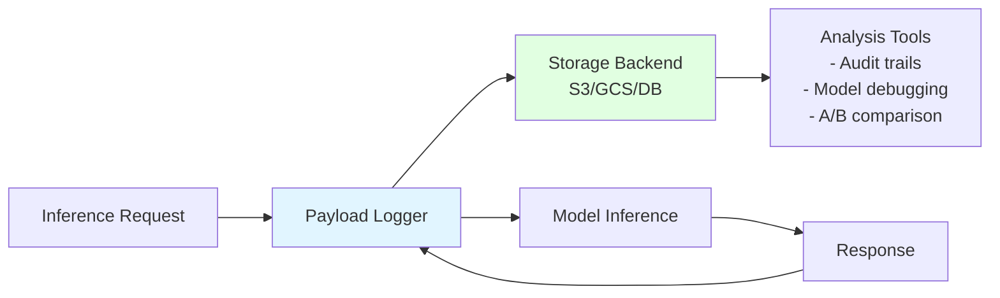
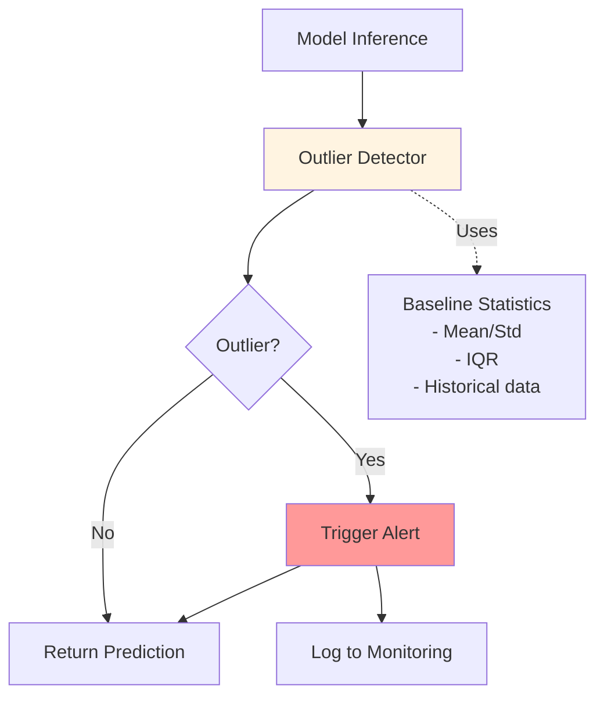
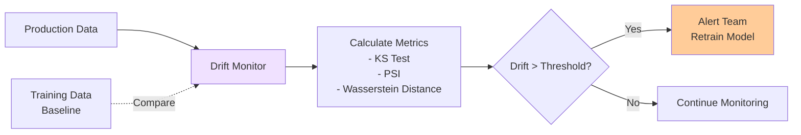
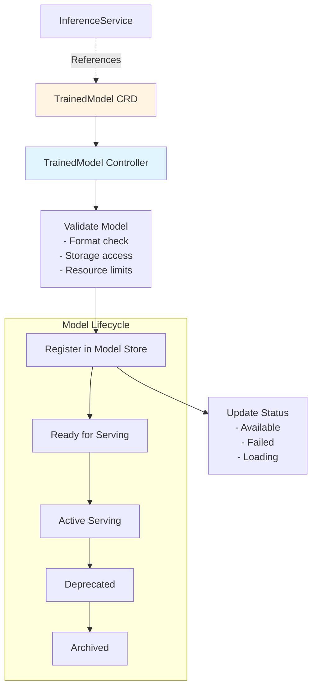
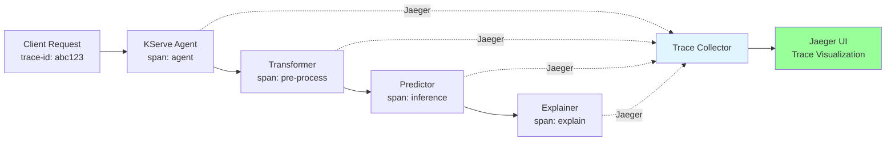
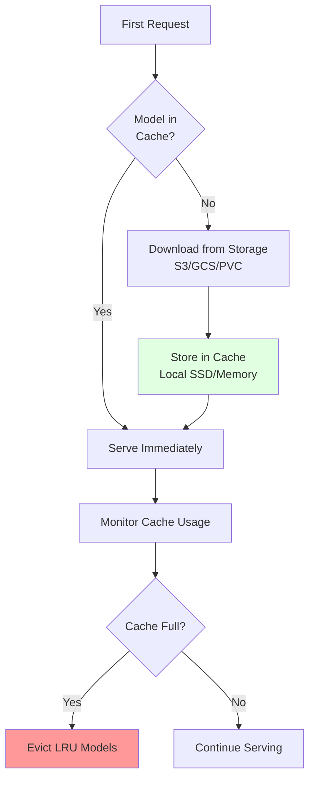

# Quick Additions to Existing KServe Documentation

**Date**: November 6, 2025  
**Purpose**: Enhance existing documents with missing features  
**Estimated Effort**: 2-4 hours

---

## 📝 Overview

This document provides specific sections that can be quickly added to existing documentation files to improve coverage of features mentioned in the official KServe website but not detailed in our docs.

---

## 🎯 Priority Additions

### 01-KSERVE-OVERALL-ARCHITECTURE.md

#### Add Section: Advanced Monitoring Features

**Location**: After "Generative AI Features" section  
**Estimated Time**: 20 minutes

```markdown
### Advanced Monitoring & Observability

KServe provides comprehensive monitoring capabilities beyond basic metrics:

#### Payload Logging


**Features**:
- **Request/Response Logging**: Capture inputs and outputs for audit
- **Selective Logging**: Log based on conditions (errors, specific users)
- **Privacy Controls**: Redaction and anonymization support
- **Storage Options**: S3, GCS, databases, message queues

**Configuration**:
```yaml
apiVersion: serving.kserve.io/v1beta1
kind: InferenceService
metadata:
  name: model-with-logging
spec:
  predictor:
    logger:
      mode: all  # all, request, response
      url: http://message-dumper.default
    model:
      modelFormat:
        name: sklearn
      storageUri: s3://models/sklearn-model
```

#### Outlier Detection

**Purpose**: Identify anomalous predictions that may indicate:
- Data quality issues
- Adversarial attacks
- Model drift
- Edge cases



**Methods**:
- Statistical (Z-score, IQR)
- Isolation Forest
- One-class SVM
- Autoencoders

**Configuration**:
```yaml
spec:
  predictor:
    outlierDetector:
      storageUri: s3://models/outlier-detector
      resources:
        limits:
          cpu: 100m
          memory: 256Mi
```

#### Drift Detection

**Purpose**: Monitor model performance degradation over time

**Drift Types**:
1. **Data Drift**: Input distribution changes
2. **Concept Drift**: Input-output relationship changes
3. **Prediction Drift**: Output distribution changes



**Configuration**:
```yaml
spec:
  predictor:
    driftDetector:
      modelUri: s3://drift-detector
      window: 1000  # samples
      threshold: 0.05  # p-value
```

#### Adversarial Detection

**Purpose**: Identify intentionally crafted inputs designed to fool the model

**Detection Strategies**:
- Input validation
- Prediction confidence analysis
- Adversarial example detection models
- Ensemble disagreement

---

### Model Protocol Summary

**Location**: After "Core Components" section  
**Estimated Time**: 15 minutes

```markdown
### Model Protocols

KServe supports three inference protocols:

| Protocol | Use Case | Format | Status |
|----------|----------|--------|--------|
| **V1** | Legacy KServe | Custom JSON | Deprecated |
| **V2** | Open Inference Protocol | Standardized | Recommended |
| **OpenAI** | LLM/GenAI | Chat completions | GenAI optimized |

#### V2 Protocol (Recommended)

**Endpoints**:
- `POST /v2/models/{model}/infer` - Inference
- `GET /v2/models/{model}` - Model metadata
- `GET /v2/models/{model}/ready` - Readiness check
- `GET /v2/health/ready` - Server health

**Request Example**:
```json
{
  "inputs": [
    {
      "name": "input",
      "shape": [1, 224, 224, 3],
      "datatype": "FP32",
      "data": [[[ ... ]]]
    }
  ]
}
```

#### OpenAI Protocol (GenAI)

**Endpoints**:
- `POST /openai/v1/completions`
- `POST /openai/v1/chat/completions`
- `POST /openai/v1/embeddings`

**Chat Example**:
```json
{
  "model": "llama-2-70b",
  "messages": [
    {"role": "user", "content": "Hello!"}
  ],
  "stream": true
}
```

**See detailed documentation**: [08-MODEL-PROTOCOLS.md](./08-MODEL-PROTOCOLS.md) (planned)
```
```

---

## 02-INFERENCESERVICE-CONTROLLER.md

#### Add Section: TrainedModel Controller

**Location**: After "InferenceService Controller" section  
**Estimated Time**: 25 minutes

```markdown
### TrainedModel Controller

**Purpose**: Manages model versions independently from InferenceService



**CRD Example**:
```yaml
apiVersion: serving.kserve.io/v1alpha1
kind: TrainedModel
metadata:
  name: model-v2
spec:
  inferenceService: my-service
  model:
    storageUri: s3://models/model-v2
    framework: sklearn
    memory: 4Gi
  config:
    maxWorkers: 2
```

**Benefits**:
- Version multiple models
- Decouple model updates from deployment
- Centralized model registry
- Model lineage tracking

**Usage with InferenceService**:
```yaml
apiVersion: serving.kserve.io/v1beta1
kind: InferenceService
metadata:
  name: my-service
spec:
  predictor:
    model:
      modelFormat:
        name: sklearn
      storageUri: trainedmodel://model-v2
```
```

---

## 03-DATA-PLANE-COMPONENTS.md

#### Add Section: Distributed Tracing

**Location**: After "Monitoring Integration" section  
**Estimated Time**: 15 minutes

```markdown
### Distributed Tracing

**Purpose**: Track requests across all components



**Benefits**:
- End-to-end request visibility
- Latency breakdown by component
- Dependency mapping
- Performance bottleneck identification

**Configuration**:
```yaml
spec:
  predictor:
    containers:
    - name: kserve-container
      env:
      - name: JAEGER_AGENT_HOST
        value: jaeger-agent.istio-system
      - name: JAEGER_AGENT_PORT
        value: "6831"
```

**Trace Context Propagation**:
- Uses W3C Trace Context standard
- Automatic span creation per component
- Custom span attributes for model metadata
```

---

## 05-PREDICTOR-RUNTIME.md

#### Add Section: Model Caching

**Location**: After "LLM Optimizations" section  
**Estimated Time**: 20 minutes

```markdown
### Model Caching

**Purpose**: Reduce model loading time and improve cold start performance



**Cache Strategies**:

1. **In-Memory Cache**
   - Fastest access
   - Limited capacity
   - Best for: Small models, frequently accessed

2. **Local SSD Cache**
   - Larger capacity
   - Fast access
   - Best for: Large models, moderate access

3. **Persistent Volume Cache**
   - Shared across pods
   - Pod restart resilient
   - Best for: Multi-pod deployments

**Configuration**:
```yaml
spec:
  predictor:
    model:
      storageUri: s3://models/large-llm
      cache:
        enabled: true
        type: local-ssd  # memory, local-ssd, pvc
        size: 100Gi
        evictionPolicy: lru
```

**Model Pre-loading**:
```yaml
spec:
  predictor:
    model:
      storageUri: s3://models/model
      preload: true  # Load during pod initialization
```

**Cache Metrics**:
- Cache hit rate
- Cache eviction rate
- Cache size usage
- Model load time

**Benefits**:
- 10-100x faster cold starts
- Reduced storage I/O
- Lower cloud storage costs
- Better user experience
```

---

## 06-RAW-KUBERNETES-DEPLOYMENT.md

#### Add Note: Feature Limitations

**Location**: Beginning of "Why Raw Deployment?" section  
**Estimated Time**: 5 minutes

```markdown
### ⚠️ Feature Limitations in Raw Deployment Mode

**Important**: Raw Kubernetes deployment does NOT support:

| Feature | Serverless | Raw K8s | Notes |
|---------|-----------|---------|-------|
| **Scale-to-zero** | ✅ Yes | ❌ No | Always runs min replicas |
| **Canary deployment** | ✅ Yes | ❌ No | Manual traffic management needed |
| **Request-based autoscaling** | ✅ Yes | ⚠️ Limited | Only HPA with standard metrics |
| **Revision management** | ✅ Yes | ❌ No | Manual version management |
| **Traffic splitting** | ✅ Yes | ⚠️ Basic | Via Ingress or Service Mesh |
| **Automatic rollback** | ✅ Yes | ❌ No | Manual rollback required |

**When to use Raw Deployment**:
- ✅ Simple, predictable workloads
- ✅ Minimum complexity requirement
- ✅ Steady traffic patterns (no scale-to-zero needed)
- ✅ Existing K8s expertise
- ✅ Air-gapped or restricted environments

**When to use Serverless (Knative)**:
- ✅ Variable workloads
- ✅ Need scale-to-zero for cost optimization
- ✅ Want advanced deployment strategies (canary, blue-green)
- ✅ Require automatic rollback
- ✅ Need fine-grained traffic control
```

---

## Quick Reference: Key Missing Topics

### Topics Covered in Official KServe but Missing/Incomplete in Our Docs

1. ✅ **Model Protocols** - Added summary, needs dedicated doc
2. ✅ **Advanced Monitoring** - Added comprehensive section
3. ⚠️ **Canary Deployments** - Mentioned, needs detailed guide
4. ❌ **InferenceGraph** - Not documented, high priority
5. ❌ **Transformer Patterns** - Basic coverage, needs examples
6. ❌ **Explainer Integration** - Not documented
7. ⚠️ **ModelMesh** - Architecture mentioned, needs deep dive
8. ⚠️ **Knative Details** - Basic integration shown, needs deep dive
9. ⚠️ **Autoscaling (KPA)** - HPA covered, KPA details missing
10. ❌ **Batch Inference** - Not covered
11. ❌ **Security** - Not covered
12. ❌ **Custom Runtime Dev** - Not covered

---

## 📋 Implementation Checklist

### Immediate (Today)
- [ ] Add monitoring section to 01-ARCHITECTURE
- [ ] Add protocol summary to 01-ARCHITECTURE
- [ ] Add feature limitations note to 06-RAW-DEPLOYMENT

### This Week
- [ ] Add TrainedModel section to 02-CONTROLLER
- [ ] Add tracing section to 03-DATA-PLANE
- [ ] Add model caching section to 05-PREDICTOR
- [ ] Update README with gap analysis link
- [ ] Update INDEX with new document

### Next Week
- [ ] Create 08-MODEL-PROTOCOLS.md
- [ ] Create 13-MONITORING-OBSERVABILITY.md
- [ ] Enhance canary deployment coverage

---

**Total Estimated Time for Quick Additions**: 2-3 hours  
**Total Estimated Time for New Documents (Phase 2)**: 20-30 hours

---

**Last Updated**: November 6, 2025  
**Status**: Ready for implementation


